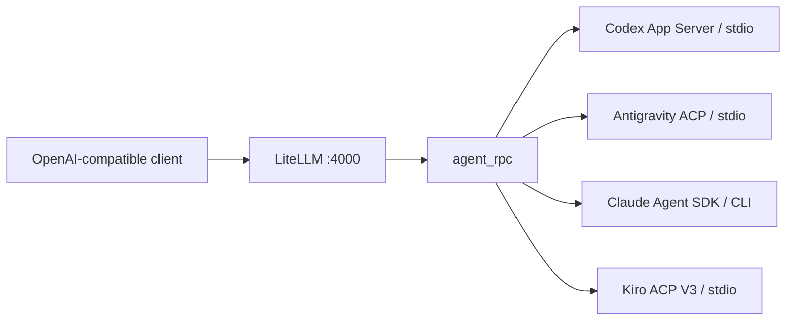

# LiteLLM Agent RPC

Một package ở root (`litellm-agent-rpc`), một LiteLLM provider (`agent_rpc`),
một API server OpenAI-compatible. Provider gọi trực tiếp adapter trong bốn
subproject; mỗi adapter điều khiển CLI tương ứng qua protocol riêng.



Không còn HTTP server trung gian cho từng backend. Runtime của adapter và
session pool nằm trong cùng tiến trình LiteLLM; CLI vẫn là process con.

Ví dụ cấu hình và client: [localhost, Docker và LiteLLM Python SDK](example/README.md).

Giao diện quản lý terminal: [hướng dẫn TUI](docs/tui.md).

```powershell
uv sync --frozen --extra tui
uv run --no-sync agent-rpc tui --config .local/config.json
```

TUI quản lý service, backend, đăng nhập qua CLI chính thức, model routes và usage.
Textual là dependency tùy chọn; gateway chạy bình thường khi không cài extra này.
Tasks & Workflows hiện lưu draft tắt mặc định; chưa có engine tự gọi agent.

V2 có cấu hình và màn hình quản lý opt-in cho tool calling, reasoning và usage:
[ví dụ V2](example/v2/README.md) và [plan/evidence](docs/cli-capabilities-v2.md).
Các capability CLI V2 vẫn bị gate; kiểm thử driver giả không phải nghiệm thu
CLI thật. Claude được giữ gate đóng theo yêu cầu.

| Backend | Source độc lập | Model alias | Trạng thái |
| --- | --- | --- | --- |
| Codex | `litellm-codex-rpc/` | `codex-default` | Bật mặc định; cần CLI đã đăng nhập |
| Antigravity | `litellm-antigravity-rpc/` | `antigravity` | Bật mặc định; cần `agy 1.5.x` (1.5.3+) đã đăng nhập |
| Claude | `litellm-claude-rpc/` | `claude-default` | Tắt mặc định; V1 chạy khi cài extra `claude` & đã login (V2 giữ gate) |
| Kiro | `litellm-kiro-rpc/` | `kiro-default` | Tắt mặc định; còn gate cô lập CLI |

## Cài và chạy

Yêu cầu Python 3.11–3.13, `uv`, source của bốn adapter tại đúng các thư mục trên.
Chỉ cần cài và đăng nhập CLI của backend sẽ sử dụng. Từ root:

```powershell
python scripts/workspace.py setup --dev
python scripts/workspace.py serve router
```

`setup` cài **một `.venv` tại root**, khóa LiteLLM `1.109.0` bằng `uv.lock`.
Không cài bốn distribution LiteLLM riêng vào cùng venv: build root gom source
của các adapter vào một distribution. `setup` không có `--dev` chỉ cài runtime.
Chạy server foreground, Ctrl+C để dừng và thu hồi runtime/CLI đã tạo.

Có thể gọi entry point trực tiếp sau setup:

```powershell
uv run --no-sync agent-rpc serve --config .local/config.json
```

Chỉ một terminal server. `serve codex`, `serve antigravity`, `serve claude` và
`serve kiro` tại workspace launcher không còn là cách khởi chạy stack.

## Cấu hình

`setup` giữ nguyên `.local/config.json`; nếu là schema cũ thì migrate có backup.
Không đổi key, model hay executable hiện có.

- `enabled`: bật/tắt từng backend. Backend tắt không được import hoặc khởi tạo.
- `ports.router`: cổng duy nhất, mặc định `4000`, bind `127.0.0.1`.
- `keys.router`: API key duy nhất client cần; không phải credential của CLI.
- `executables`: đường dẫn/tên CLI. Claude dùng CLI đi kèm SDK khi giá trị là null.
- `codex_model`, `antigravity_models`, `claude_models`, `kiro_models`: ánh xạ model CLI.
- `codex_limits`, `antigravity_limits`, `claude_limits`, `kiro_limits`: giới hạn session/concurrency/deadline của adapter.
- `allow_prompt_flattening` (tùy chọn): cho phép flatten lịch sử nhiều lượt và role `system`/`developer` thành JSON văn bản có thứ tự cho các route V1 (hoặc bật theo từng route qua `settings.flatten`).
- `router_timeout`: deadline ngoài, mặc định 350 giây; nên lớn hơn timeout adapter và cleanup.
- `routes` (tùy chọn): map alias tới `{backend, model, settings, enabled}`; cho
  phép nhiều alias trên cùng backend. Nếu có, đây là danh sách route chính thức;
  nếu chưa có, các alias/model cũ được giữ nguyên. `enabled` của backend vẫn áp dụng.
- `default_route` (tùy chọn): alias mặc định trong giao diện; API client vẫn phải
  gửi trường `model`. Đổi mapping cần drain và start/recreate service để áp dụng.

Các port/key backend cũ được giữ để tương thích schema, **không được sử dụng**
trong luồng một provider. Cấu hình `.local/` bị loại khỏi Git.
Launcher sinh cấu hình LiteLLM chỉ với alias được bật; mỗi route dùng
`agent_rpc/<alias>` và cùng một `custom_provider_map` entry.
Không cấu hình `api_base` trỏ tới backend HTTP.

Claude SDK là extra tùy chọn. `setup` cài extra khi `enabled.claude=true`;
để phát triển adapter khi chưa bật route:

```powershell
uv sync --frozen --extra claude
```

Chỉ đổi `enabled` chưa đủ để vượt gate phát hành. Claude còn cần nghiệm thu
tools/hooks và session thực tế; Kiro còn cần chứng minh cô lập cấu hình cùng
đăng nhập CLI hiện có. Xem [Claude/Kiro](docs/claude-kiro.md).

## API chung

Base URL: `http://127.0.0.1:4000/v1`. Dùng key `keys.router`.

```python
import json
from pathlib import Path
from openai import OpenAI

config = json.loads(Path('.local/config.json').read_text(encoding='utf-8'))
client = OpenAI(
    base_url=f"http://127.0.0.1:{config['ports']['router']}/v1",
    api_key=config['keys']['router'],
    max_retries=0,
)
reply = client.chat.completions.create(
    model='codex-default',
    messages=[{'role': 'user', 'content': 'Chào bạn'}],
)
print(reply.choices[0].message.content)
```

Hỗ trợ `/v1/models`, `/v1/chat/completions`, `/v1/responses` (`store: false`,
`instructions`, `input`), cả completion thường lẫn SSE. Mặc định Codex/Antigravity
nhận một user text message (hoặc bật `allow_prompt_flattening` / `settings.flatten`
để nhận lịch sử + `system`/`developer`); Claude/Kiro có `system`/`developer` +
lịch sử và reuse bằng `X-Conversation-ID`. Reuse chỉ tiếp tục khi lịch sử hoàn
tất khớp chính xác; đổi lịch sử hay cấu hình tạo session mới. Không header thì
session mới cho mỗi request.

Không tự retry/fallback. Tham số không hỗ trợ, tool calling, ảnh/audio và
transport override bị từ chối. Hủy HTTP request được truyền xuống adapter.
Gateway bỏ usage do LiteLLM có thể tự ước tính số token; không công bố số ước tính
như usage thực. Không tự đọc/sao chép token đăng nhập của CLI.

## Kiểm tra

```powershell
python scripts/workspace.py check
uv run --no-sync agent-rpc doctor --config .local/config.json
```

`check` kiểm tra gateway và danh sách alias. Backend được khởi tạo lười khi
gọi lần đầu; danh sách model không chứng minh backend sẵn sàng.
`doctor` kiểm tra các backend được bật, rồi đóng runtime; không gửi prompt.
Kết quả preflight không chứng minh quota hay quyền gọi model.

```powershell
uv run --no-sync pytest -q
uv run --no-sync ruff check src scripts tests
uv run --no-sync ruff format --check src scripts tests
uv build
```

Test HTTP mới chạy một LiteLLM thật với adapter giả tại ranh giới provider,
kiểm tra cả bốn alias, auth, completion/SSE, hội thoại và disconnect; không có
backend HTTP server. Test topology HTTP cũ được giữ để kiểm tra hồi quy, dùng
`scripts/serve_router.py` và `config/router.legacy.yaml`.
CI root kiểm tra dispatcher/policy bằng fixture; chưa build toàn bộ adapter từ
checkout sạch vì các repo nguồn chưa được khai báo Git submodule/publish đầy đủ.

## Đóng gói và repo độc lập

`uv build` tạo **một wheel** chứa provider root và source adapter từ bốn thư mục.
Wheel cài được trên máy không có các source repo; dùng `agent-rpc serve --config
<path>` với file cấu hình riêng. CLI tương ứng vẫn cần được cài và đăng nhập.
Wheel không chứa `.local/`, credential hay `.git/`; xem [notices](THIRD_PARTY_NOTICES.md).

Các thư mục con vẫn là repo độc lập, được root `.gitignore` loại trừ. Hiện chúng
**chưa phải Git submodule đã đăng ký**. Clone riêng root chưa đủ để build wheel:
cần checkout đủ source của bốn adapter tại đúng đường dẫn. Bản build hiện tại
dùng source cục bộ, bao gồm thay đổi chưa commit của adapter cũ; chưa phải release
tái tạo được chỉ từ remote. Adapter Codex được bổ sung `stdio_cwd` để giữ thư mục
tạm riêng cho CLI mà không đổi working directory của gateway. Các thay đổi cục
bộ có sẵn trong repo con được giữ nguyên.

Quyết định kiến trúc: [ADR 0004](docs/adr/0004-unified-agent-rpc.md).
Kết quả kiểm chứng: [unified plugin](docs/unified-plugin.md).
