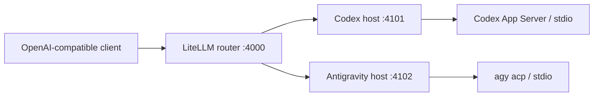

# LiteLLM ACP Router

Workspace chuẩn bị triển khai bộ plugin LiteLLM kết nối tới agent CLI ở backend.
Router cung cấp một OpenAI-compatible endpoint; mỗi adapter chạy trong process và
Python environment riêng vì hai plugin đang khóa phiên bản LiteLLM khác nhau.

Claude và Kiro đã có implementation trong hai repo độc lập
`litellm-claude-rpc/` và `litellm-kiro-rpc/`, mặc định **tắt**. Chưa backend mới
nào được nghiệm thu CLI thật: Claude cần đăng nhập; Kiro bị khóa bởi điều kiện
cô lập tools/hooks và login. Xem [hướng dẫn tích hợp](docs/claude-kiro.md).



| Thành phần | Thư mục | LiteLLM | Model alias |
| --- | --- | --- | --- |
| Router dùng chung | Gốc workspace | 1.109.0 | `codex-default`, `antigravity` |
| Plugin Codex | `litellm-codex-rpc/` | 1.80.7 | `codex-default` |
| Plugin Antigravity | `litellm-antigravity-rpc/` | 1.109.0 | `antigravity` |
| Plugin Claude (tùy chọn) | `litellm-claude-rpc/` | 1.109.0 | `claude-default` |
| Plugin Kiro V3 (đang khóa) | `litellm-kiro-rpc/` | 1.109.0 | `kiro-default` |

Không cài hai plugin vào cùng venv. Adapter thực hiện chuyển đổi protocol; router
giao tiếp với hai API host qua HTTP. Codex App Server dùng protocol riêng, không
phải ACP. Luồng đăng nhập thuộc CLI chính thức, router không đọc OAuth token.

## Thiết lập tại máy hiện tại

Yêu cầu Python 3.11–3.13, `uv`, Codex CLI và Antigravity CLI đã đăng nhập.
Antigravity adapter hiện yêu cầu chính xác `agy 1.5.3`. Codex adapter ghi nhận
phiên bản kiểm chứng `0.163.0`; cần kiểm thử lại khi CLI thay đổi.

Chạy từ thư mục gốc bằng PowerShell hoặc terminal:

```powershell
python scripts/workspace.py setup --dev
```

Lệnh này dùng `uv sync --frozen` với lockfile riêng cho router và các backend
được bật. Cấu hình có năm key riêng; backend tắt không cần cài CLI hoặc venv.
Config cũ được migrate sang schema 2 với backup `.local/config.json.v1.bak`,
giữ nguyên key/port/model/executable cũ. Không tự đăng nhập, chạy server hay gọi model.
`setup` không có `--dev` cài profile runtime. Trên Linux có thể dùng `python3`.
Dừng dịch vụ trước khi cài lại để Windows có thể thay executable. Không copy
`.venv` giữa thư mục: launcher có thể giữ đường dẫn cũ. Nếu gặp lỗi
`uv trampoline failed to canonicalize script path`, cài lại package sở hữu
launcher trong đúng project (ví dụ `uv sync --frozen --extra dev --extra proxy
--reinstall-package litellm --reinstall-package pytest` tại thư mục Codex).

Chỉnh `.local/config.json` nếu cần:

- `ports`: cổng của ba dịch vụ; mặc định 4000/4101/4102, luôn bind loopback.
- `executables`: tên CLI trên PATH hoặc đường dẫn tuyệt đối tới executable.
- `codex_model`: `null` dùng mặc định của Codex; hoặc model ID của tài khoản.
- `antigravity_models.antigravity`: model/thought level do tài khoản ACP công bố.
  Giá trị `gemini-4-carbon` trong mẫu cần được startup xác nhận; không đảm bảo quota.
- `keys`: key riêng bảo vệ HTTP gateway; không phải credential của nhà cung cấp.
- `enabled`: bật/tắt riêng Codex, Antigravity, Claude và Kiro; router chỉ công bố
  alias được bật. Hai backend mới mặc định false.

`.local/` bị loại khỏi Git. File key được tạo với mode 0600 trên POSIX; Windows
dùng ACL kế thừa từ thư mục. Đặt workspace trong tài khoản Windows riêng của
người vận hành. Không gửi file này cho client; chỉ cấp key `router` khi cần.

## Chạy ba dịch vụ

Mở ba terminal ở thư mục gốc, mỗi terminal chạy một lệnh:

```powershell
python scripts/workspace.py serve codex
python scripts/workspace.py serve antigravity
python scripts/workspace.py serve router
```

Mỗi lệnh chạy foreground; Ctrl+C dừng dịch vụ trong terminal đó. Cổng đang bị
chiếm sẽ làm lệnh thất bại, không dừng tiến trình khác. Chạy backend trước router.
Không dùng `uv run` ở thư mục gốc để chạy executable của subproject.

Từ terminal thứ tư:

```powershell
python scripts/workspace.py check
```

`check` kiểm tra venv, executable và gọi `/v1/models` của cả ba dịch vụ với đúng
key; trả exit code khác 0 khi thiếu hoặc không kết nối được. Không gửi prompt,
không chứng minh entitlement/quota. Router có thể trả danh sách model ngay cả
khi backend tắt, vì vậy cần kiểm tra trực tiếp cả hai backend như lệnh này.

## Dùng endpoint chung

Base URL: `http://127.0.0.1:4000/v1`. Lấy `keys.router` từ config cục bộ.

```python
import json
from pathlib import Path
from openai import OpenAI

config = json.loads(Path('.local/config.json').read_text(encoding='utf-8'))
client = OpenAI(
    base_url=f"http://127.0.0.1:{config['ports']['router']}/v1",
    api_key=config['keys']['router'],
    max_retries=0,
)
reply = client.chat.completions.create(
    model='codex-default',  # hoặc 'antigravity'
    messages=[{'role': 'user', 'content': 'Chào bạn'}],
)
print(reply.choices[0].message.content)
```

Profile Codex/Antigravity hỗ trợ **một user text message**, stateless, completion và SSE.
Không bật tool calling, ảnh/audio, lịch sử hội thoại, system/developer messages,
sampling/token limit hay Responses API. Router không mở rộng khả năng adapter.
Không tự flatten role hoặc bỏ tham số; backend vẫn kiểm tra hợp đồng đầu vào.
CLI phía sau vẫn có giới hạn cô lập được ghi trong tài liệu của từng plugin.

Retry ở router/provider SDK và fallback đều tắt để tránh lặp agent turn khi kết
quả chưa rõ. Timeout backend là 300s Codex, 120s Antigravity; upstream/router
được đặt dài hơn để có thời gian nhận lỗi và cleanup. Không bật model health
check nền vì kiểu kiểm tra đó có thể phát sinh prompt.

## Kiểm thử và nghiệm thu

```powershell
uv run --frozen pytest -q
uv run --frozen ruff check scripts tests
uv run --frozen ruff format --check scripts tests
uv run --directory litellm-codex-rpc --frozen --extra dev --extra proxy python -m pytest -q
uv run --directory litellm-antigravity-rpc --frozen --extra dev python -m unittest discover -s tests -v
```

Test ở root khởi động LiteLLM Proxy thật với hai HTTP backend giả để xác nhận
auth, model routing, completion/SSE, bảo toàn payload và không retry/fallback khi
backend lỗi. Không gọi agent CLI thật. CI root chạy bộ này trên Windows/Linux;
CI nằm trong `.github/` của hai repo con thuộc vòng đời riêng của từng repo.

Kết quả xác minh tại máy này: [docs/VALIDATION.md](docs/VALIDATION.md).

Nghiệm thu model thật qua router, **hai request tính quota cho mỗi lệnh**:

```powershell
uv run --frozen python scripts/smoke_live.py --live --model codex-default
uv run --frozen python scripts/smoke_live.py --live --model antigravity
```

## Quản lý mã nguồn và chuẩn bị release

Quyết định: giữ hai plugin thành Git repo độc lập. Repo gốc chỉ quản lý router,
cấu hình và công cụ triển khai; mỗi plugin có commit/release/CI riêng:

- [litellm-codex-rpc](https://github.com/OrgGem/litellm-codex-rpc)
- [litellm-antigravity-rpc](https://github.com/OrgGem/litellm-antigravity-rpc)

Workspace giữ nguyên `.git` và thay đổi cục bộ của chúng. `.gitignore` của root
loại trừ chính xác hai thư mục plugin để tránh stage source hoặc gitlink ngoài
ý muốn. Không dùng Git submodule. Commit/push plugin từ repo tương ứng, ví dụ
`git -C litellm-codex-rpc status` và `git -C litellm-antigravity-rpc status`.

Trên máy mới, sau khi clone repo router, clone từng plugin vào thư mục tương ứng
(chỉ thực hiện nếu thư mục đó chưa tồn tại):

```powershell
git clone https://github.com/OrgGem/litellm-codex-rpc.git litellm-codex-rpc
git clone https://github.com/OrgGem/litellm-antigravity-rpc.git litellm-antigravity-rpc
```

Antigravity hiện chưa có commit đầu tiên, còn Codex có mã host chưa commit.
Vì vậy **clone các repo hiện chưa tái tạo được hai backend đang có trên máy này**.

Để chốt release: review/commit/push từng plugin trước, ghi lại commit/tag của cả
hai plugin trong bản phát hành router và checkout đúng các phiên bản đó khi
triển khai. Cần kiểm thử lại `setup` trên bản clone sạch. Chưa thực hiện
commit/push trong bước setup.

Profile này chuẩn bị chạy local trên Windows; chưa cài Windows Service, chưa
triển khai Docker toàn bộ stack và chưa mở cổng public. Trước production cần
chốt phiên bản nguồn, chạy live acceptance, chọn service supervisor/tài khoản
runtime và cấu hình TLS/access control nếu phục vụ qua mạng. Không dùng nguyên
Compose của subproject Codex cho cả stack: Compose đó chỉ dành cho Codex Unix socket.

Tài liệu cấu hình LiteLLM: [router configuration](https://docs.litellm.ai/docs/router/api_reference/configuration),
[proxy configuration](https://docs.litellm.ai/docs/proxy/config_settings).
